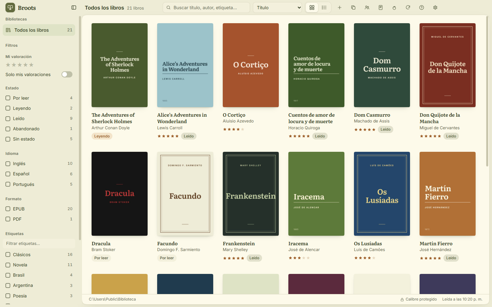
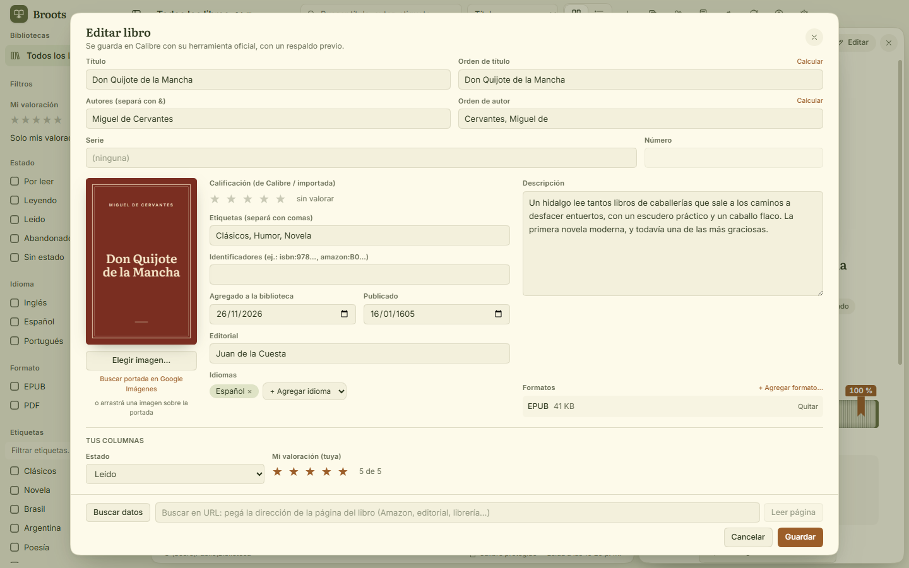
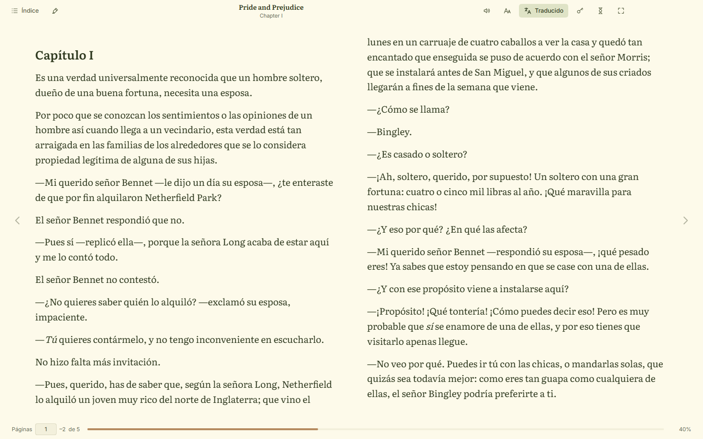
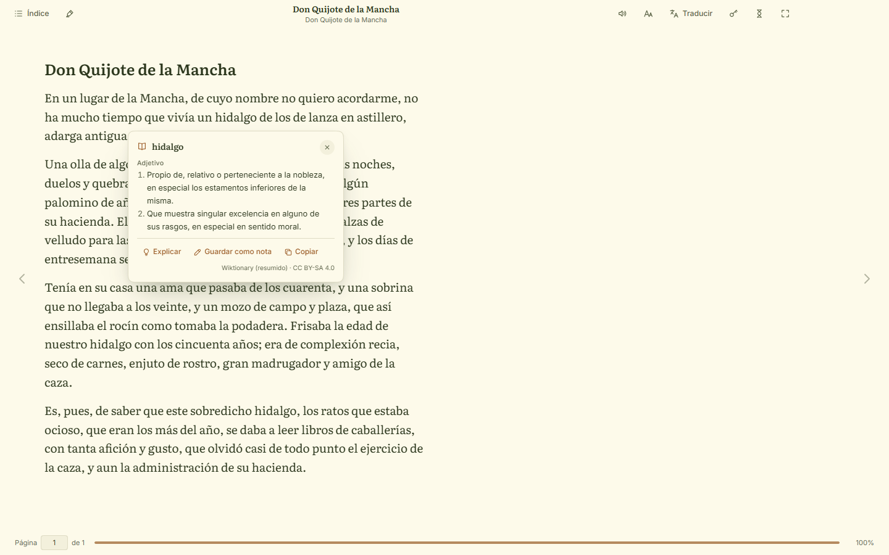
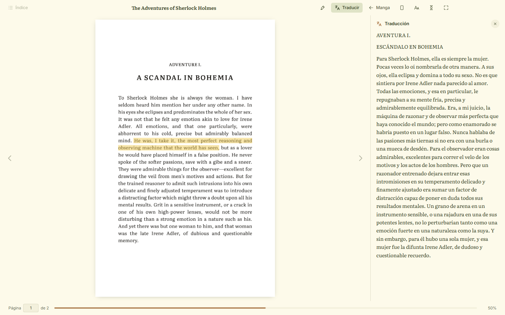
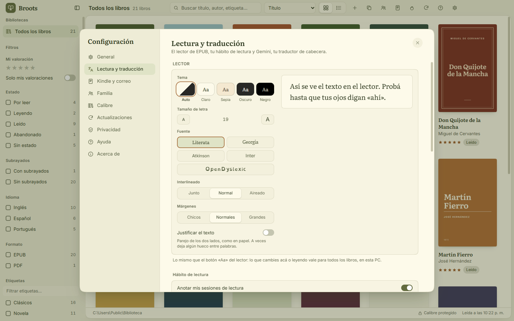

# Broots

**Tu biblioteca de libros electrónicos, compatible con Calibre.** Una app para Windows para ordenar, buscar,
editar y leer tus e-books (EPUB, PDF y cómics), subrayarlos, traducirlos, escucharlos en voz alta, mandarlos a tu
Kindle y compartirlos con tu familia.

Broots es gratis y es software libre. **[Bajar la última versión](https://github.com/IVANICUSXXIII/broots/releases/latest)**.

> **English.** An e-book manager for Windows that works right on top of your Calibre library. Browse your shelf,
> edit everything, and read EPUB, PDF and comics with highlights and notes, translation as you read, an offline
> dictionary and read-aloud voices. Send books to your Kindle and share them with your family. Free software
> (GPL-3.0 or later), in English, Spanish and Brazilian Portuguese, and it updates itself.
> [Download the latest version](https://github.com/IVANICUSXXIII/broots/releases/latest).
> The installer isn’t digitally signed yet ([why](#code-signing-policy)), so Windows will say “Windows protected
> your PC”: click “More info” and then “Run anyway”. It’s built by GitHub Actions from the code in this repository,
> and each release lists its SHA-256.
>
> **Português.** Um gerenciador de e-books para Windows que funciona direto na sua biblioteca do Calibre. Estante
> de capas, edição completa e leitura de EPUB, PDF e quadrinhos com destaques e notas, tradução enquanto você lê,
> dicionário sem internet e leitura em voz alta. Envie livros para o Kindle e compartilhe com a família. Software
> livre (GPL-3.0 ou posterior), em português do Brasil, inglês e espanhol, e se atualiza sozinho.
> [Baixe a versão mais recente](https://github.com/IVANICUSXXIII/broots/releases/latest).
> O instalador ainda não tem assinatura digital, então o Windows vai dizer “O Windows protegeu o computador”:
> clique em “Mais informações” e depois em “Executar assim mesmo”. Ele é gerado pelo GitHub Actions a partir do
> código deste repositório, e cada versão mostra o seu SHA-256.

<picture>
  <source media="(prefers-color-scheme: dark)" srcset="docs/capturas/estanteria-oscuro.png">
  
</picture>

## Qué es Broots

Broots trabaja sobre la misma carpeta que [Calibre](https://calibre-ebook.com/), el gestor de libros
electrónicos más usado del mundo. No hay que importar ni copiar nada: abrís Broots y ves tu biblioteca de
siempre, con otra cara.

Calibre y Broots conviven. Lo que cambiás en uno lo ves en el otro, porque los dos usan el mismo archivo de
la biblioteca (`metadata.db`).

## Broots y Calibre

- Broots lee tu biblioteca directamente, pero **nunca la cambia por su cuenta**: cada cambio lo hace con las
  herramientas oficiales de Calibre, de a uno por vez.
- Antes de cada cambio guarda un respaldo de la base en la carpeta `.broots/respaldos`, dentro de tu
  biblioteca.
- Si Calibre está instalado en tu PC, Broots usa ese. Si no, descarga una copia oficial de sus herramientas
  desde el sitio de Calibre, la verifica y la mantiene al día sola.
- Broots no es parte de Calibre ni lo reemplaza. Si Calibre te sirve, considerá
  [donarle](https://calibre-ebook.com/donate): sin Calibre, Broots no existiría.

## Qué podés hacer

**Tu biblioteca**

- **Tu estantería:** tus libros en grilla o en lista, con portadas grandes, filtros por autor, etiqueta,
  serie, estado de lectura o idioma, y el buscador con las mismas búsquedas que Calibre (`tags:novela`,
  `rating:>3`…). Las etiquetas con jerarquía de Calibre («Sagas.Harry Potter») se ven en árbol, y también las
  bibliotecas virtuales que armaste. Doble clic en una portada y ya estás leyendo.
- **Editar:** todos los datos de un libro (título, autores, serie, etiquetas, fechas, editorial, tus columnas
  propias), la portada y los formatos. «Buscar datos» trae datos y portadas de Google Books y Open Library, o
  de la página de un libro que pegues.
- **Agregar y convertir:** arrastrá archivos a la ventana para sumarlos. Si un archivo no trae datos, Broots
  saca del nombre el título, el autor y la serie. Si un libro no tiene EPUB o PDF, lo convierte con las
  herramientas de Calibre.
- **Libros repetidos:** Broots encuentra los libros que tenés dos veces y te deja elegir cuál conservar,
  sin perder formatos ni subrayados.

**Leer**

- **Lector de EPUB, a tu medida:** tema (claro, sepia, oscuro o negro), cinco fuentes (entre ellas Atkinson,
  muy legible, y OpenDyslexic), tamaño, interlineado y márgenes. Pellizcá el trackpad para agrandar la letra y
  tocá una imagen para verla en grande.
- **PDF y cómics:** PDF y cómics (CBZ y CBR) de a una o dos páginas, con zoom y manga de derecha a izquierda.
  En los PDF también podés seleccionar texto, subrayar, anotar, definir, explicar y traducir. No abre archivos
  con DRM ni con contraseña.
- **Traducir:** con una clave gratuita de Gemini (tuya), Broots traduce el libro mientras leés: en un EPUB,
  párrafo por párrafo en el lugar (tocás uno y ves el original); en un PDF, en un panel al costado.
- **Explicar:** seleccioná una palabra, un nombre o una frase y Gemini te cuenta qué quiere decir ahí, sin
  spoilers.
- **Definir:** seleccioná una palabra y mirá qué significa, al instante y sin internet. Hay diccionario de
  español, inglés y portugués, armados con Wiktionary; cada uno se baja la primera vez que lo pedís. Entiende
  las palabras conjugadas: «corrió» te lleva a «correr».
- **Escuchar:** Broots te lee el libro en voz alta, resaltando el párrafo que suena y pasando de página solo.
  Sin internet, con voces que se bajan la primera vez (Daniela, con acento argentino, para español; Kristin
  para inglés y Faber para portugués), o con la voz de Gemini. Si el párrafo está traducido, lee la traducción.
  Por ahora, en EPUB.
- **Subrayados y notas:** subrayá en cuatro colores y anotá lo que se te ocurra, en EPUB y en PDF. Tus
  subrayados del Kindle aparecen en la misma lista, y cada libro tiene su archivo Markdown para Obsidian o
  Notion, que se actualiza solo.
- **Hábito de lectura:** Broots anota tus sesiones de lectura (con meta opcional y descanso para la vista) y
  te muestra tu racha, tu ritmo, el mapa de calor del año y cuánto te falta para terminar cada libro. Estados
  En pausa y Abandonado, relecturas y un modo enfoque que deja solo el texto.

**Y además**

- **Kindle:** mandá libros a tu Kindle por mail, desde tu cuenta de Gmail, e importá tus subrayados (el
  archivo `My Clippings.txt`). Si un libro está en el Kindle pero no en tu biblioteca, lo podés sumar.
- **Club de lectura:** llevá un libro con tus subrayados y notas a Claude, Gemini o NotebookLM, para charlar
  sobre él con una inteligencia artificial.
- **Familia:** compartí libros con la gente de tu casa. Broots arma en tu Google Drive una copia solo con
  los libros de cada uno, que ellos abren en modo solo lectura.
- **En tu idioma:** español, inglés y portugués de Brasil, con tema claro y oscuro.
- **Ayuda:** un tour de bienvenida y un manual completo dentro de la app (tecla F1), con buscador.

## Cómo se ve

Las capturas usan una biblioteca de ejemplo con clásicos de dominio público. Si tu GitHub está en modo oscuro,
las ves con el tema oscuro de Broots.

**Editar un libro.** Todos los datos, la portada y tus columnas propias de Calibre, en una sola hoja.

<picture>
  <source media="(prefers-color-scheme: dark)" srcset="docs/capturas/editar-oscuro.png">
  
</picture>

**El lector, traduciendo.** *Pride and Prejudice* en inglés, leído en español. Tocá un párrafo para ver el
original.

<picture>
  <source media="(prefers-color-scheme: dark)" srcset="docs/capturas/lector-oscuro.png">
  
</picture>

**Definir, sin internet.** ¿Qué era un hidalgo? Seleccionás la palabra y Broots te lo dice al instante, aunque
estés en un avión.

<picture>
  <source media="(prefers-color-scheme: dark)" srcset="docs/capturas/definir-oscuro.png">
  
</picture>

**Un PDF, subrayado y traducido.** *The Adventures of Sherlock Holmes* en PDF: seleccionás el texto como en una
página web, lo subrayás, y la traducción va en un panel al costado.

<picture>
  <source media="(prefers-color-scheme: dark)" srcset="docs/capturas/pdf-oscuro.png">
  
</picture>

**Configuración.** Ordenada por secciones, como en macOS.

<picture>
  <source media="(prefers-color-scheme: dark)" srcset="docs/capturas/configuracion-oscuro.png">
  
</picture>

## Cómo instalarlo

Necesitás Windows 10 u 11 y una biblioteca de Calibre. Si todavía no usás Calibre, instalalo, abrilo una vez
para crear tu biblioteca y sumá algunos libros.

1. Bajá el instalador más reciente («Instalar-Broots-X.Y.Z.exe») de la
   [página de versiones de Broots](https://github.com/IVANICUSXXIII/broots/releases/latest) en GitHub.
2. Abrilo. Como el instalador todavía no tiene firma digital, Windows muestra el aviso «Windows protegió su
   PC»: tocá «Más información» y después «Ejecutar de todas formas». El aviso no quiere decir que Broots tenga
   un virus: Windows lo muestra con cualquier programa nuevo que no tenga firma (un certificado que cuesta plata
   o que una fundación da gratis a los proyectos con usuarios; Broots lo va a pedir de nuevo más adelante). Si
   querés comprobar que el archivo es el original, cada versión muestra su huella SHA-256 y una constancia de que
   lo armó GitHub a partir del código de este repositorio.
3. Broots busca solo la biblioteca de Calibre de tu PC. Si no la encuentra, te pide que elijas la carpeta
   (la que tiene el archivo `metadata.db`). Puede estar en Google Drive.

Desde la 1.6.0, Broots se actualiza solo: cada vez que lo abrís (y cada seis horas si queda abierto) se fija si hay una versión nueva, la baja y la
instala cuando lo cerrás. Se apaga en Configuración → Actualizaciones. Si tenés una versión anterior,
instalá la nueva encima: tu configuración queda como estaba.

## Privacidad

Broots trabaja en tu PC y **no tiene servidores propios**: tu biblioteca, tus subrayados y tus notas no se
mandan a ningún lado por su cuenta. Esto es lo único que sale de tu PC, y solo cuando usás esa función:

| Qué | Hacia dónde | Cuándo |
|---|---|---|
| El texto de los párrafos que traducís | Gemini (Google) | Solo si cargaste tu clave y activaste la traducción en el lector. |
| Lo que seleccionás para «Explicar», con el párrafo que lo rodea | Gemini (Google) | Cuando tocás «Explicar». |
| El texto que escuchás con la voz de Gemini | Gemini (Google) | Solo si elegiste esa voz en «Escuchar». Las voces sin internet leen en tu PC. |
| La descarga de un diccionario o de una voz | GitHub (diccionarios) y Hugging Face (voces) | La primera vez que usás «Definir» o «Escuchar» en un idioma. No viaja nada tuyo. |
| El libro que enviás al Kindle | Gmail (Google) → Amazon | Cuando tocás «Enviar al Kindle». |
| Título, autor e ISBN del libro que buscás | Google Books y Open Library | Cuando tocás «Buscar datos» al editar un libro. |
| Lo mismo, también a Amazon | Amazon | Solo si lo prendés en Configuración → Privacidad (viene apagado). |
| Las herramientas de Calibre | GitHub y calibre-ebook.com | Si Calibre no está instalado: Broots descarga su copia oficial y revisa una vez por semana si hay versión nueva. No viaja nada tuyo. |
| La consulta por versiones nuevas de Broots | GitHub | Cada vez que abrís Broots (y cada seis horas si queda abierto), y la descarga si hay una. No viaja nada tuyo. Se apaga en Configuración → Actualizaciones. |

- Tu biblioteca y las copias de Familia están en carpetas de tu PC (o de Google Drive). Si están en Drive,
  las sube el programa de Google Drive, no Broots.
- La contraseña de aplicación de Gmail y la clave de Gemini las escribís vos. Se guardan cifradas por Windows
  en tu PC y Broots no las vuelve a mostrar nunca.
- Broots **no quita la protección (DRM)** de ningún libro: los libros protegidos se copian tal cual.

## Apoyar a Broots

Broots es gratis. Si te sirve, podés apoyar a quienes lo hacen posible:

- [Donar a Calibre](https://calibre-ebook.com/donate), la base de todo.
- [Invitar un cafecito al autor](https://cafecito.app/IVANICUSXXIII), desde Argentina.
<!-- Cuando la página de GitHub Sponsors del autor esté activa, sumar:
- [Apoyar al autor en GitHub Sponsors](<dirección>), desde cualquier país. -->


## Licencia

Broots es software libre, con licencia [GNU GPL versión 3](LICENSE) o posterior: podés usarlo, compartirlo
y cambiarlo. Si publicás una versión cambiada, también tiene que ser libre y con su código abierto.

Lee PDF con [pdf.js](https://github.com/mozilla/pdf.js) (Apache 2.0) y cómics RAR con [libarchive](https://github.com/libarchive/libarchive)
(BSD), a través de [libarchive-wasm](https://github.com/ofk/libarchive-wasm) (MIT), y lee en voz alta con
[sherpa-onnx](https://github.com/k2-fsa/sherpa-onnx) (Apache 2.0) y [espeak-ng](https://github.com/espeak-ng/espeak-ng)
(GPL 3). Los diccionarios son un resumen de [Wiktionary](https://www.wiktionary.org/) (CC BY-SA 4.0) y viven en
[su propio repositorio](https://github.com/IVANICUSXXIII/broots-diccionarios); las voces sin internet son las del
proyecto [Piper](https://huggingface.co/rhasspy/piper-voices), cada una con su licencia. Todos los avisos están en
[`app/licencias-de-terceros.txt`](app/licencias-de-terceros.txt).

Broots usa las herramientas de [Calibre](https://calibre-ebook.com/), de Kovid Goyal y su comunidad (también
GPL versión 3), y está hecho con Electron, React, Motion y Tailwind CSS, con las fuentes Inter y Literata.
El sonido del matasuegras es «Party horn 2», de Joseph Sardin en [BigSoundBank.com](https://bigsoundbank.com/),
libre de derechos.

Broots no está asociado con Calibre, Amazon ni Google. Kindle es una marca de Amazon.

## Code signing policy

*Política de firma de código* (en inglés, como la pide SignPath) · *Política de assinatura de código* (em inglês).

Free code signing provided by [SignPath.io](https://about.signpath.io/), certificate by
[SignPath Foundation](https://signpath.org/). Until the project is approved, Broots installers are not signed yet.

- **What gets signed:** only Broots’ own Windows installer (`Instalar-Broots-X.Y.Z.exe`). It is built by GitHub
  Actions ([`instalador.yml`](.github/workflows/instalador.yml)) from the source code in this repository, at the
  commit each release points to, and every release lists its SHA-256 and has a
  [build provenance attestation](https://github.com/IVANICUSXXIII/broots/attestations). Nothing built on a
  personal computer is signed. Calibre’s tools, which Broots may download when Calibre is not installed, are not
  part of the installer and keep Calibre’s own signature.
- **Team and roles:** Broots is maintained by [IVANICUSXXIII](https://github.com/IVANICUSXXIII), who is its only
  committer and reviewer (changes proposed by anyone else are reviewed before they are included) and the approver
  of every signing request, one by one. The maintainer’s accounts use multi-factor authentication.
- **Privacy policy:** this program will not transfer any information to other networked systems unless
  specifically requested by the user or the person installing or operating it, with two exceptions that send no
  personal data: the check for new versions of Broots on GitHub (when Broots opens and every six hours; it can be
  turned off in Settings → Updates) and, only when Calibre is not installed, the download of Calibre’s official
  tools from GitHub and calibre-ebook.com and a weekly check for new versions of them. Everything else happens only
  when the user uses that feature: translating, explaining or reading aloud text with Gemini (Google), with the
  user’s own key; downloading a dictionary (from GitHub) or an offline voice (from Hugging Face); sending a book
  to a Kindle through the user’s Gmail account; and looking up a book’s title, author and ISBN on Google Books and
  Open Library (and Amazon, only if the user turns it on). Broots has no servers of its own and no telemetry. Details, in Spanish, in
  [Privacidad](#privacidad).

## Para quien quiera programar

Todo el código está en la carpeta `app/` (Electron, React y Tailwind). Hace falta [Node.js](https://nodejs.org/).
Este repositorio recibe el código de cada versión publicada, un commit por versión («Broots X.Y.Z»), y la versión de
la página de descargas apunta a ese commit. El código de la 1.6.2 se subió después de publicarla: es el primer commit
con código. Desde la 1.6.3, el instalador lo arma GitHub Actions a partir de ese código
([`instalador.yml`](.github/workflows/instalador.yml)), con su huella SHA-256 y una constancia de origen.

```
cd app
npm install
npm run dev                       # Broots en modo desarrollo
node pruebas/correr.mjs todos     # pruebas automáticas
node pruebas/capturas.mjs         # vuelve a sacar las capturas de este README (hace falta Calibre)
npm run instalador                # arma el instalador de Windows (para probar)
npm run publicar                  # publica la versión: GitHub Actions arma el instalador (hace falta permiso)
```

Las pruebas nunca tocan tu biblioteca: copian su base y algunos libros a una carpeta temporal y, al final,
comprueban que la original no cambió (antes hay que abrir Broots una vez con tu biblioteca). Las reglas técnicas del proyecto están en [`CLAUDE.md`](CLAUDE.md).
